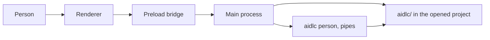

# Build Navigator

Navigator is the Electron app in `proposals/navigator.md`: one window on Windows, macOS, and Linux that shows where an AI-DLC workflow is and carries the person's own decisions into it. The coding agent keeps drafting documents and code.

Work stays on `feat/navigator` in `/mnt/c/repo/aidlc-workflows` (`C:\repo\aidlc-workflows`), based on current `awslabs/aidlc-workflows` `main`. The pull request goes back to that repository later. This plan does not open it.

## How the app sits in the repo

The app is a private package at `app/navigator/`. It does not go under `core/` or `harness/`. The root `package.json` scripts (`typecheck`, `lint`, `check`) stay pointed at the framework. The app has its own `package.json`, `tsconfig.json`, and test script. Bun installs and runs it, matching the rest of the repo.

Generated harness files (`.grok/`, `.claude/`, and the rest) stay out of the pull request. Upstream `main` does not ship a Grok harness. The product code calls the public `aidlc` command, so it is the same on every harness.

This Grok session is open on `greet-cli`. After this plan is approved, the Navigator workflow starts in the `aidlc-workflows` checkout. Running `/aidlc` in the greet session would attach to the finished greet work.

## What the first version does

Reading uses the record on disk. Actions use the `aidlc` command installed for the opened project. When that command is missing, or the presence check refuses it, the window still shows status and documents and marks the action unavailable with the reason. The window ships in a light theme and a dark theme. It follows the operating system until the person chooses Light, Dark, or System.

One next action, in this order:

1. A blank `[Answer]:` on a question file for the current stage.
2. The current stage checkbox is `[?]` (approval waiting).
3. A bolt for this work is waiting on the person.
4. Team construction has a unit free to claim.
5. Nothing is waiting.

Out of the first version, as the one-pager says: no model chat, no editing of application code, no accounts or hosted service, no per-agent plugin, and no creation of an `aidlc/` record when the folder has none. Settings does not grow past appearance, the workflow command, and the harness model controls above.

## Usability

The window is a map of one piece of work. These are the extras that serve that job.

In the first version:

- **Recent projects.** Reopen one of the last few folders from this machine, beside the folder picker.
- **Which piece of work.** When the space has more than one open intent, the person picks it. The screen does not invent an active-intent cursor.
- **One primary action.** The next action (answer, approve, claim, or bolt) is the obvious control. Other actions stay available and do not compete with it.
- **A draft survives a refresh.** An answer or comment the person is typing stays put when files change on disk, until they send it or that question is gone.
- **Copy the document path.** The open stage document can be copied as a path, so the person can point the coding agent at the file they just read.

Later, not in the first version: an operating-system notification when a question or approval appears while the window is in the background, search across the intent's markdown, and a diff of a document the agent just rewrote. Each of those is a separate pass after the map and the actions work.

## Architecture

Text fallback: the window talks only to the main process. The main process reads `aidlc/` and runs `aidlc person` over pipes. The command updates the record.

## How other apps talk to a local CLI

Two patterns show up in current open-source apps. Navigator follows the second. The citations are the lesson. Navigator does not speak Agent Client Protocol, and this repository does not implement an ACP server.

**Embed the CLI in a real terminal.** [DPlex](https://www.reddit.com/r/electronjs/comments/1t6lntf/built_a_multiplexer_for_ai_cli_sessions_in/), [ClaudeTerminal](https://github.com/Mr8BitHK/claude-terminal), [Agentic Terminal Wrapper](https://github.com/ParkerM2/Agentic-Terminal-Wrapper), [DevTerm](https://github.com/AEmad99/devterm), and Forgeboard spawn Claude Code, Codex, or Copilot CLI with `node-pty` and draw it with xterm.js. The person types in that terminal, so the CLI really is talking to a person. That product is a terminal for the coding agent. Navigator's one-pager keeps the coding agent outside the window, so this pattern is the wrong fit. Two of their lessons still apply: a GUI does not inherit a login shell's `PATH` (DPlex wraps a login shell, then `exec`s the CLI), and on Windows `node-pty` cannot spawn a `.cmd` shim directly (ClaudeTerminal spawns `cmd.exe /c`).

**Give the CLI an explicit client contract, and never pretend to be a terminal.**

- [Goose](https://github.com/aaif-goose/goose) desktop (about 56k stars) launches the `goose` binary and talks [Agent Client Protocol](https://github.com/aaif-goose/goose/discussions/7697) on `127.0.0.1`, with a shared secret (`GOOSE_SERVER__SECRET_KEY`). The GUI is a client. Maintainers are collapsing the CLI, the desktop, and other UIs onto that one protocol.
- [Zed](https://zed.dev/docs/ai/external-agents) starts an external agent as `command` + `args` (ACP) and logs the messages. It does not scrape the agent's screen.
- acpx, the headless ACP client in front of Claude Code and Codex, and Vercel's `fx` do the same from a process with no screen: JSON or NDJSON on stdout, interactive login left to the person.
- [GitHub Desktop](https://github.com/desktop/desktop/blob/development/vendor/desktop-trampoline/README.md) spawns `git` with `GIT_TERMINAL_PROMPT=0` and a `GIT_ASKPASS` trampoline. Git never blocks on a terminal. When it needs the person, the trampoline calls back to the Electron app over localhost. The GUI owns the prompt; it does not allocate a pseudo-terminal so git will believe a person is sitting there.
- ClaudeTerminal's status path is the other half: Claude Code hooks write to a named pipe, and the app does not parse CLI output.

`commandAtPersonsTerminal` in `core/tools/aidlc-lib.ts` is the "person typed this in their shell" test: both ends are terminals, and no agent-host mark is set. A pipe fails it. Allocating a pseudo-terminal inside Electron would be the trick GitHub Desktop refused for git, and it would also drop the agent-host marks only if we stripped the environment. Navigator does not do that.

The matching contract is a public non-interactive command. Pipes are the normal case. A person's own shell can run the same command. An agent host cannot.

### How Kiro uses the CLI

Kiro keeps two programs apart. `kiro-cli` is the chat the person sits in. `aidlc` is the framework command both the hook and the model run.

The person starts `kiro-cli chat` in the project. The installed `.kiro/settings/cli.json` sets `chat.defaultAgent` to `aidlc`, so the conductor is already selected. They type `/aidlc ...` in that chat. A Kiro hook runs first for status, doctor, help, version, and workspace navigation, and it runs the `aidlc` command itself. The model never sees those as workflow work. The hook decodes the child's stdout as UTF-8 and strips terminal control bytes before showing the text. Everything else the conductor does, it does by running `aidlc engine ...`. On a native install those engine commands are pre-approved, plus a short list of read-only `aidlc` commands (`doctor`, `status`, `version`, `config --show`). A test, a build, a `git push`, a recursive delete, and any other `config` change still ask the person. A source checkout uses `bun .kiro/tools/aidlc.ts` for the same split. `kiro-cli chat --no-interactive` has nobody to ask, so Kiro refuses anything outside the pre-approved set.

Questions on Kiro are numbered lines in the chat. The questions file, with its `[Answer]:` tags, stays the source of truth. The person's reply is a chat message. The hooks record that message as `HUMAN_TURN`. A prompt Kiro writes itself is `HOST_TURN` and answers nothing. If the hooks never run, every approval is refused.

ACP is a second front end on the same `kiro-cli` binary, not a second framework. `kiro-cli acp` replaces `kiro-cli chat`. The client has to answer `session/request_permission` or Kiro treats the silence as a permission failure. Those requests are Kiro asking about a tool. They are not an AI-DLC stage gate. Hooks still have to run: `kiro-cli acp --agent-engine v2` on the `kiro` harness, and on the `kiro-ide` harness the client must start `--agent-engine v3` and send `clientCapabilities._meta.kiro.hooks` as `{ enabled: true, v2: true }`. This repository does not implement an ACP server of its own.

Navigator copies Kiro's split and leaves Kiro's chat alone.

- The window reads the record, the way Kiro's hook runs `aidlc --status` without asking the model.
- A click runs the native `aidlc` command, the same binary the hook runs. It does not run `aidlc engine` for a change, and it does not run `bun .kiro/tools/aidlc.ts`. The one engine read it runs is `aidlc engine runtime summary --json`, which the session-cost guide tells a person to run.
- The runner's command list is fixed: `aidlc person`, `aidlc unit`, `aidlc config models`, `aidlc engine runtime summary --json`, `aidlc usage show --json`, and the read-only commands. There is no general shell, which is the same boundary as Kiro's pre-approved list.
- Shown command output is plain text with terminal control bytes removed, matching the hook's relay.
- A person who is in `kiro-cli chat` or `kiro-cli acp` keeps answering Kiro's tool prompts there. Navigator does not become that client. Stage answers and gates go through `aidlc person`, on every harness, because the questions file is the source of truth and the window has no Kiro chat to type a number into.

## App shape

Main process:

- `contextIsolation: true`, `nodeIntegration: false`, `sandbox: true`.
- Content security policy stays on the app's own files. No remote page loads, no auto-update, no telemetry.
- Preload exposes a small API: open project, read snapshot, set answer, approve, claim, release, bolt action. The renderer never receives a shell or a filesystem handle.
- Preferences live in the Electron user-data directory only. See Settings below.

Renderer:

- Status header, next action, stage document list, rendered markdown, and the action for that next step.
- Markdown is rendered with raw HTML turned off, so text inside a stage document cannot become a script or a link that leaves the machine.
- Usable at a normal laptop width. The same screens ship on all three systems.
- Light and dark themes ship together. The default follows the operating system until the person chooses Light, Dark, or System in Settings. Status, documents, questions, and actions use the same tokens in both themes, so body text and the next-action control stay readable when the theme changes. The markdown view uses those tokens too.

## Settings

Yes. One Settings screen. It configures the window, and it can set the model policy the opened project's harness already honors. It does not open a model chat, and it does not take a provider key. Scope, depth, guards, and team rules stay in the project's AI-DLC record and in the coding agent's chat.

The screen has three parts:

1. **Appearance.** Light, Dark, or System. System is the default and follows the operating system.
2. **Workflow command.** The detected `aidlc` path. Empty means the resolver above. The person can point at a binary when detection is wrong or the GUI cannot see `PATH`. A missing or rejected command still leaves status and documents on screen, with actions marked unavailable and this setting named in the reason.
3. **Model, for this harness.** Reads `aidlc config models --show` and writes only through `aidlc config models`. The controls depend on the harness installed in the opened project, matching [Choosing a Model and Effort](https://github.com/awslabs/aidlc-workflows/blob/main/docs/guide/18-install-and-lifecycle.md#choosing-a-model-and-effort):

| Harness in the project | What Settings can change |
| --- | --- |
| Kiro CLI | The session model and its one effort, saved in that person's Kiro settings (`aidlc config models --session-model`). The list is the one Kiro returns for the account. A preset sets that one effort (`minimal` low, `balanced` medium, `thorough` extra-high). |
| Claude Code, Codex CLI, opencode | The effort preset, and a model or effort for one agent. A preset sets effort only, never a model id. |
| Kiro IDE | A model and effort for one agent. The session model stays whatever the Kiro chat is using. The screen says that. |
| Cursor, GitHub Copilot | Nothing to apply. Every agent uses the model of the chat where `/aidlc` runs. The screen says that, and names the host. |

A per-agent or preset change is for this person (`--local`) unless they explicitly choose "for this project" (`--project`). Kiro CLI's session model is always that person's own Kiro settings, so the project choice does not apply to it. The screen shows the command's own result, including an undo line when the command prints one. Navigator does not contact a model provider. On Kiro CLI, `aidlc config models` is what asks Kiro for the account's model list.

The app also remembers, without putting them on the screen as configuration: a short list of recent project folders, the window bounds, and the last team name typed on a claim, used only to prefill the next claim. Nothing else is stored. No account, no model key, no project file contents.

Record reader (pure TypeScript, tested without Electron):

- `aidlc/active-space`, then `aidlc/spaces/<space>/intents/active-intent`.
- That intent's `aidlc-state.md`: lifecycle phase, current stage, next stage, status, and the six checkbox states already documented (`[ ]`, `[-]`, `[?]`, `[R]`, `[x]`, `[S]`).
- Stage documents from `aidlc/spaces/<space>/intents/<intent>/<phase>/<stage>/`.
- Question files named `*-questions.md`. An empty answer is a line that is only `[Answer]:` or `[Answer]:` plus whitespace.
- When the cursors are missing, read `intents.json` and ask which piece of work to open. Do not invent a cursor.
- Refresh from a debounced watch on `aidlc/`. Opening a project reads the state file and the current stage directory, so a few hundred markdown files stay within a couple of seconds.

Command runner:

- Resolve the native `aidlc` command from `PATH`, then the documented install paths: `%LOCALAPPDATA%\aidlc\bin\aidlc.cmd` on Windows and `$HOME/.local/bin/aidlc` on macOS and Linux. A GUI started from the desktop often does not see a PATH change made after it was installed, so the fallback paths matter. On Windows, spawn the `.cmd` shim through `cmd.exe /d /s /c` with quoted arguments, because a direct spawn of a `.cmd` file fails and `shell: true` would re-parse the arguments. This is the binary Kiro's hook runs. The runner does not call `aidlc engine` or `bun .kiro/tools/aidlc.ts`.
- Working directory is the opened project. Standard input and output are pipes. Inherit the environment unchanged, including any agent-host mark.
- Do not allocate a pseudo-terminal. Do not set `AIDLC_SKIP_HUMAN_PRESENCE_GUARD`.
- Read status from the record. Use `aidlc --status` only as a diagnostic, not as the screen's source. ClaudeTerminal's hook pipe is the same idea: the structured record is the API, the transcript is not.

## Framework gap to close on this branch

Public commands already cover part of the window:

- `aidlc --status` and the state file for the map.
- `aidlc unit status` for free, claimed, and waiting units (JSON).
- `aidlc unit claim <unit> --team "<label>"` and `aidlc unit release <unit>`.

Approvals and question answers are still written by the coding agent after a chat reply (`aidlc engine orchestrate report` and `aidlc engine log answer`). The guide calls `aidlc engine` harness machinery, not a stable script interface. The question file remains the source of truth, and the documented person path is to edit `[Answer]:` and tell the agent.

Add two public commands in `core/tools/`, wired through the existing dispatcher, and document them in `docs/guide/12-cli-commands.md`:

- `aidlc person answer --file <questions.md> --id <question-id> --text-file <path>` writes that question's `[Answer]:` line and records the answer the same way a person's reply is recorded today. `--text-file` keeps shell metacharacters out of the argument vector. The file is read from the opened project and then removed.
- `aidlc person gate --stage <slug> --result approved|rejected --text-file <path>` performs the stage gate the orchestrator already performs for `approved` and `rejected`, including the comment on a rejection.

Both commands accept a pipe and a person's own terminal. They refuse when an agent host has marked the environment (`TERM_PROGRAM` of `vscode`, `cursor`, or `kiro`, or a prefix such as `CLAUDECODE`, `CURSOR_`, `CODEX_`, `KIRO_`, `COPILOT_`, `VSCODE_`, `OPENCODE`) or when `AIDLC_SESSION_OVERRIDE` or `CODEX_THREAD_ID` is set. The refusal is a non-zero exit and one line the window can show. A person's shell, which has none of those marks, can run the same command. Tests sit next to the existing terminal-presence tests and cover: a pipe with a clean environment is accepted; a terminal with a clean environment is accepted; an agent-host mark is refused; a session override is refused.

Bolt actions in the first version use the same rule. The window lists bolts from the intent state and from `.aidlc/worktrees/bolt-*` (not started, running, paused, waiting). When a bolt is waiting on a question or a gate, the person answers or decides through the two commands above. A separate "create the worktree" control waits until those two commands exist and a public bolt-start route is named in the same guide. The coding agent still does the work inside the bolt.

Task N0 aligns the mob-elaboration sentence with the Method Definition Paper: Mob Elaboration is the Inception ritual where the room reviews the proposed stories, acceptance criteria, and units. Claiming a unit and running a bolt stay under Construction. The question screen itself is one screen for every blank `[Answer]:`.

## Metrics the window can show

AI-DLC already records two different kinds of numbers. Navigator shows both when they exist, and it does not invent the one that is missing.

**Workflow figures, every harness.** `aidlc engine runtime summary --json` is the session-cost view: duration, stages approved / failed / pending, counts by phase, memory entries, sensor firings, and learnings. The session-cost skill prints those fields and nothing else. It used to guess tokens from file size; that guess was removed. Before the first stage has compiled `runtime-graph.json`, the command says there is no session data yet, and the window says the same. These numbers are progress, not a bill.

**Tokens and a dollar estimate, Claude Code only.** The Claude fold hook writes `aidlc/.aidlc-sessions/usage-ledger.json` (gitignored, on this machine). The Claude statusline reads that ledger and shows tokens in, tokens out, and a USD figure. Kiro, Codex, opencode, Cursor, and Copilot do not write the ledger, so they show no token segment. The dollar figure is a local estimate from public list prices, not an invoice. Bedrock can differ from that estimate. `AIDLC_DISABLE_USAGE_TRACKING=1` stops new rows. Nothing in this path is sent off the machine. `AIDLC_METRICS_ENDPOINT` is a separate opt-in that would phone home; Navigator never sets it.

The window puts the workflow figures on the status header for every project. It adds tokens in, tokens out, and the estimate only when the ledger has totals for this workflow, with the caption "List-price estimate, not a bill." It never shows `$0` for a missing price, and it never estimates tokens from the size of the markdown. Kiro's own chat-fullness figure stays in Kiro's session file; Navigator does not read that file.

The ledger has no public command today. Slice 7 adds a read-only `aidlc usage show --json` that prints the same totals the statusline already computes, and Navigator calls that instead of parsing the ledger itself. Until the command exists, the token row stays hidden.

## Slices

Each slice is one commit series on `feat/navigator` and is usable on its own.

1. **Read path.** Package skeleton, folder picker, recent projects, missing-record message, space and intent picker, state summary, stage document list, markdown view, copy document path, Settings with appearance and the workflow-command path, light and dark themes with the System default, debounced refresh that keeps an unsaved draft. No workflow actions yet. Parser tests on fixture trees.
2. **Person commands.** `aidlc person answer` and `aidlc person gate`, with the presence tests in the framework suite. Guide section in `docs/guide/12-cli-commands.md`. The Mob Elaboration wording on the one-pager is task N0, done before this slice's code.
3. **Questions and gates in the window.** Blank answers and the `[?]` gate call the new commands over pipes. Unavailable states show the command's reason.
4. **Units.** `aidlc unit status`, claim under a team name the person types, and release. The claim command's existing rules stay in force, including team ownership and dependency blocks.
5. **Bolts.** List and status, then answer or continue a bolt that is waiting on the person, through the slice 2 commands. Worktree creation stays with the agent until a public start route is added the same way.
6. **Model settings.** The harness table above, driven by `aidlc config models --show` and the same command's write flags. A fixture per harness row checks that the screen offers only the controls that row allows, and that Cursor and Copilot render the host explanation with no apply button.
7. **Metrics.** Workflow figures from `aidlc engine runtime summary --json` on the status header. `aidlc usage show --json` for the Claude Code token and list-price totals, hidden when that command reports no ledger. A fixture with no graph says "no session data yet." A fixture with a ledger shows the three figures and the not-a-bill caption. A fixture without a ledger shows the workflow figures only.

Installers (Windows NSIS, macOS dmg, Linux AppImage) come after slice 1 works in development. They are packaging only. They do not add a feature that exists on one system.

## Tests

- Record parser and next-action picker: fixture directories, no Electron.
- Command resolver: PATH hit, Windows fallback, Unix fallback, missing binary.
- Framework tests for the two new commands and the four caller cases: clean pipe, clean terminal, agent-host mark, session override.
- Development smoke on this Windows machine: open a project that has an `aidlc/` record, see the current stage, render one document, switch between the light theme and the dark theme in Settings, submit one answer, approve or send back. macOS and Linux stay on the same code path; a full installer pass on those two systems happens when a machine for each is available.

## Spec and task board

Building Navigator is spec-driven so a later session can see which tasks are still pending. After approval, three files on `feat/navigator` are that record. They live in `proposals/` so the board exists before `app/navigator/` is scaffolded, and so the published docs site does not pick them up.

- `proposals/navigator.md` — product spec. Already on the branch. The first commit after approval brings it in line with this plan.
- `proposals/navigator-plan.md` — this build plan, copied into the repo in that same commit.
- `proposals/navigator-tasks.md` — the task board, written in that same commit.

### What a new session does

Any harness, on any machine that has the branch, starts by reading `proposals/navigator-tasks.md`. The board file itself carries this header:

- Product behavior comes from `proposals/navigator.md`. Build decisions come from `proposals/navigator-plan.md`. Progress comes from this board.
- Each task has an id, a status (`pending`, `in progress`, or `done`), a slice, a done-when line, and the files it touches.
- At most one task is `in progress`.
- Continue the first Build task whose status is `pending` or `in progress`. Leave a `done` task as it is.
- Before editing code for that task, set it to `in progress`. In the same commit as the work, set it to `done`.
- If a later decision changes scope, update `proposals/navigator-plan.md` and the affected tasks in that same commit.

This session's plan file stays on this machine. A harness todo list stays in that session. `aidlc/active-space` and `aidlc/spaces/*/intents/active-intent` are gitignored per-user cursors, so a fresh clone does not have them. When AI-DLC is running for this build, `aidlc-state.md` in the intent record tracks workflow stages. The task board tracks implementation tasks. The intent record stays off the upstream pull request until the RFC issue asks for it. The three proposal files stay on the branch and are part of the pull request.

The other machine sees the board once `feat/navigator` is on `vinodabh/aidlc-workflows`. Push when you ask, including at the end of a session before you switch machines. This revision does not push.

### Spec update in the first commit (N0)

N0 is done in the same commit that adds the plan copy and the board, and the board marks N0 `done`. That commit updates `proposals/navigator.md` to the approved product surface:

- Package path `app/navigator/`.
- Light and dark themes, default System, chosen in Settings.
- Settings limited to appearance, the workflow command, and the harness model controls in this plan. Recent projects, window bounds, and the last team name typed on a claim are remembered and are not shown as extra settings.
- Next-action order from this plan: blank `[Answer]:`, then `[?]`, then a bolt waiting on the person, then a free unit, then nothing.
- Missing cursors: read `intents.json` and ask which work to open. Do not invent a cursor.
- Requirement 11 matches the bolt rule in this plan: list bolts and answer or continue one that is waiting. Creating the worktree stays with the coding agent until a public bolt-start route exists.
- Mob Elaboration is the Inception ritual where the room reviews the proposed stories, acceptance criteria, and units. Claiming a unit and running a bolt stay under Construction. The question screen is one screen for every blank `[Answer]:`.
- Metrics from this plan: workflow figures on every harness; tokens and the list-price estimate only when the Claude ledger has totals, with the caption "List-price estimate, not a bill."
- The deleted sentence that began "This app is its own effort" stays deleted.
- "After this page" points at `proposals/navigator-plan.md` and `proposals/navigator-tasks.md`.

### Build tasks

These rows are copied into `proposals/navigator-tasks.md`. N0 is `done` in the first commit. Every other row is `pending`.

| Id | Slice | Done when | Files |
| --- | --- | --- | --- |
| N0 | Spec | The one-pager matches the list under "Spec update in the first commit". | `proposals/navigator.md` |
| N1 | 1 | `app/navigator` is a private package with its own `package.json`, `tsconfig.json`, and test script. Bun runs that test script. Root `typecheck`, `lint`, and `check` still point at the framework. | `app/navigator/package.json`, `app/navigator/tsconfig.json`, the test entry |
| N2 | 1 | Parser tests pass on fixture trees: missing `aidlc/`, several open intents, the six checkbox states, blank `[Answer]:` tags, and the next-action order. | Parser and fixtures under `app/navigator/` |
| N3 | 1 | The dev window opens a project, reopens a recent project, picks a space and intent, shows the state summary and stage documents, renders markdown with raw HTML off, copies the open document path, and keeps an unsaved draft across a debounced refresh. | Electron main, preload, and renderer under `app/navigator/` |
| N4 | 1 | Settings offers Light, Dark, and System (System default). Both themes keep body text and the next-action control readable. The workflow-command path can be set, and the resolver tests cover a PATH hit, the Windows fallback, the Unix fallback, and a missing binary. Preferences stay in the Electron user-data directory. | Theme tokens, Settings, and the resolver under `app/navigator/` |
| N5 | 2 | `aidlc person answer` and `aidlc person gate` accept a clean pipe and a clean terminal, and refuse an agent-host mark and a session override. The four caller tests pass. The guide section is in `docs/guide/12-cli-commands.md`. | `core/tools/` command modules and dispatcher, the presence tests, `docs/guide/12-cli-commands.md` |
| N6 | 3 | A blank answer and a `[?]` gate call those commands over pipes. A missing or refused command leaves status and documents up and shows the reason. Windows smoke: open a project with an `aidlc/` record, see the current stage, render one document, switch themes, submit one answer, approve or send back. | Action path under `app/navigator/` |
| N7 | 4 | The window shows `aidlc unit status`, claims with a team name the person types, and releases. Ownership and dependency refusals from the existing command show as the reason. | Units UI under `app/navigator/` |
| N8 | 5 | The window lists bolts from intent state and `.aidlc/worktrees/bolt-*` (not started, running, paused, waiting) and answers or continues a waiting bolt through the person commands. | Bolts UI under `app/navigator/` |
| N9 | 6 | Settings reads `aidlc config models --show` and writes only through `aidlc config models`. One fixture per harness row offers only that row's controls. Cursor and Copilot show the host explanation with no apply button. A per-agent or preset change uses `--local` unless the person chooses "for this project". | Model section of Settings under `app/navigator/` |
| N10 | 7 | `aidlc usage show --json` prints the same totals the statusline computes, and an empty result when the ledger is absent. Tests cover both. | Usage command and its tests, `docs/guide/12-cli-commands.md` |
| N11 | 7 | The status header shows workflow figures from `aidlc engine runtime summary --json`, including "no session data yet" when the graph is missing. Tokens in, tokens out, and the list-price estimate show only when `aidlc usage show --json` returns totals, with the caption "List-price estimate, not a bill." A missing ledger hides the token row. | Status header under `app/navigator/` |

Work N1 through N11 in that order. Two items sit beside that list and have their own start:

- **N12 Packaging.** Starts after N4 is done. Windows NSIS, macOS dmg, and Linux AppImage configs live under `app/navigator/`. The Windows package is produced on this machine. macOS and Linux packages are built when a machine for each is available. Packaging adds no feature that exists on only one system.
- **N13 RFC issue.** Any time after the N0 commit. Open a GitHub issue on `awslabs/aidlc-workflows` with the RFC template, covering the desktop app and the two person commands. The pull request waits until that issue exists.

## Pull request shape

The pull request from `vinodabh/aidlc-workflows` `feat/navigator` onto `awslabs/aidlc-workflows` `main` waits on the RFC issue (N13). It contains:

- `proposals/navigator.md`, `proposals/navigator-plan.md`, and `proposals/navigator-tasks.md`
- `app/navigator/`
- the `aidlc person` commands, `aidlc usage show`, their tests, and the guide section

The local AI-DLC intent record created while building Navigator stays on the branch until the issue discussion asks for it in the pull request. No version bump and no `CHANGELOG.md` edit. Those belong to release metadata pulls.

## After approval

In `/mnt/c/repo/aidlc-workflows` on `feat/navigator`:

1. Update `proposals/navigator.md` as N0 describes. Copy this plan to `proposals/navigator-plan.md`. Write `proposals/navigator-tasks.md` from the table above, with N0 `done` and every other task `pending`.
2. Commit those three files.
3. Start the AI-DLC workflow in that checkout with `proposals/navigator.md` and `proposals/navigator-plan.md` as the request. The greet-cli session keeps its finished greet workflow.
4. Implement from the board: set the first unfinished Build task to `in progress`, do that task, and mark it `done` in the same commit.

Push `feat/navigator` to the fork when you ask. That includes the end of a session, before you continue on another machine. The other machine checks out that branch and reads `proposals/navigator-tasks.md`.
