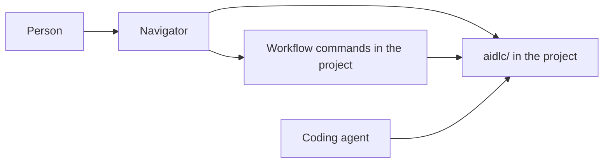

# Navigator

A one-pager for Navigator, an Electron app that helps a person follow an AI-DLC workflow on Windows, macOS, and Linux. The name is the job: where this work is, and what it is waiting on.

## Why it helps

AI-DLC keeps a written record under `aidlc/` in the project: the active piece of work, the phase, the stage, the decisions, and the documents each stage writes. The coding agent does the stage work in a chat. The chat is a poor map.

- A stage can run for a long time. The question that needs a human answer is easy to lose under the transcript.
- "Where are we?" is a line the agent says once. A later session does not replay the map.
- The record is a deep tree of markdown. The file a person is supposed to review is not obvious from the folder alone.
- The same `aidlc/` tree can be used from more than one coding agent. The transcript cannot. A person who changes agents, or machines, still needs one place that shows the workflow.
- Windows, macOS, and Linux users do not share one chat client. They can share one desktop app.

Navigator is that map, and it is also where the person acts. The coding agent still drafts the documents and the code. The person uses Navigator to see the phase and the current stage, answer a waiting question, approve a stage or send it back, claim a unit, and continue a bolt that is waiting.

Text fallback: The person uses Navigator to read `aidlc/` and to answer, claim a unit, or continue a bolt that is waiting. Navigator writes those choices through the workflow commands already installed in the project. The coding agent still drafts the documents and the code.

## Why Electron

The record is on the local disk. A website would need the person to upload the project, or to run a private server. Electron is one codebase with a normal window, a folder picker, and installers for Windows, macOS, and Linux. It works offline. Markdown in the record can be shown in the window without a separate docs site.

## Who it is for

A person who already has an AI-DLC record in a repository and wants one place to see that workflow and to take the human steps in it: answering questions, including Mob Elaboration, claiming a unit, and continuing a bolt that is waiting. Mob Elaboration is the Inception ritual where the room reviews the proposed stories, acceptance criteria, and units.

## Requirements

### Product

1. Navigator is one Electron codebase at `app/navigator/` and runs on Windows, macOS, and Linux. Each system can open a project, read status, and read documents. No feature is limited to one operating system.
2. The person opens a project folder, or reopens one of the last few folders from this machine. The app looks for `aidlc/` at the root of that folder.
3. If `aidlc/` is missing, the app says the folder has no AI-DLC record and does not create one.
4. The app shows the active space and the active intent from `aidlc/active-space` and `aidlc/spaces/<space>/intents/active-intent`. When either file is missing, the app reads `intents.json` and asks which piece of work to open. It leaves those cursor files as they are.
5. For that intent, the app shows the phase, the current stage, the status, and which stages are done, in progress, or skipped, using that intent's `aidlc-state.md`.
6. The app shows one next action, in this order: a question with a blank `[Answer]:` on the current stage, the current stage waiting for approval, a bolt waiting on the person, a unit free to claim, or nothing waiting.
7. The app lists the markdown documents for the current stage and renders the one the person selects.
8. The app shows every question that still has an empty `[Answer]:` on one screen. That includes questions raised in Mob Elaboration. Mob Elaboration is the Inception ritual where the room reviews the proposed stories, acceptance criteria, and units. The person answers in Navigator. The answer is written to that question's `[Answer]:` line. Claiming a unit and running a bolt stay under Construction.
9. When a stage is ready for a decision, the person can approve it or send it back with comments. Navigator records that choice on the workflow.
10. For team construction, Navigator lists units that are free to claim, units already claimed, and units that are waiting. The person claims a free unit under a team name they enter, and can release a unit they hold.
11. Navigator lists the bolts for the current work and shows each one as not started, running, paused, or waiting on a person. When a bolt is waiting, the person answers or decides in Navigator and continues the bolt. Creating the bolt's worktree stays with the coding agent until a public way to start that worktree exists.
12. The app refreshes when files change on disk, so an agent can keep writing while the window stays open. An answer the person is typing stays in place until they send it or that question is gone. The path of the open stage document can be copied.
13. Navigator performs answers, approvals, claims, releases, and bolt actions through the AI-DLC commands installed in the opened project. When those commands are missing, it still shows status and documents, and it shows the actions as unavailable with the reason.

### Boundaries

14. Text inside a document is data. Navigator does not follow instructions it finds in a markdown file.
15. Navigator does not copy the project's source into itself. Local preferences stay in the app's own user-data directory: recent project folders, window bounds, the theme choice, the workflow-command path, and the last team name typed on a claim.
16. Navigator does not draft stage documents or write application code. The coding agent does that work. Navigator carries the person's decisions into the workflow.

### Quality

17. A project with a few hundred markdown files under `aidlc/` shows the current stage within a couple of seconds on a typical laptop.
18. The window is usable at a normal laptop width on all three systems.
19. The app does not send file contents or project paths off the machine.

### Appearance and settings

Navigator ships a light theme and a dark theme. The default follows the operating system until the person chooses Light, Dark, or System in Settings. Status, documents, questions, actions, and markdown use the same tokens in both themes, so body text and the next-action control stay readable.

Settings is one screen. It configures the window, and it can set the model policy the opened project's coding tool already honors. It does not open a model chat, and it does not take a provider key. Scope, depth, and team rules stay in the project's AI-DLC record and in the coding agent's chat.

1. **Appearance.** Light, Dark, or System.
2. **Workflow command.** The detected `aidlc` path. Empty means Navigator looks up `aidlc` on its own. The person can point at a binary when that lookup is wrong. A missing or rejected command still leaves status and documents on screen, with actions marked unavailable and the reason shown.
3. **Model, for this project's coding tool.** Navigator reads and writes that choice only through `aidlc config models`.
   - Kiro CLI: the session model and its one effort, saved in that person's Kiro settings. A preset sets that one effort.
   - Claude Code, Codex CLI, and opencode: an effort preset, and a model or effort for one agent. A preset sets effort only.
   - Kiro IDE: a model and effort for one agent. The session model stays whatever the Kiro chat is using, and the screen says that.
   - Cursor and GitHub Copilot: nothing to apply. Every agent uses the model of the chat where `/aidlc` runs, and the screen says that.

A change for one agent or a preset is for this person unless they choose "for this project". Kiro CLI's session model is always that person's own Kiro settings.

Navigator also remembers a short list of recent project folders, the window bounds, and the last team name typed on a claim, used only to prefill the next claim. Those are not extra settings pages. Nothing else is stored. No account, no model key, no project file contents.

### What the status header counts

The status header shows workflow figures for every project: duration, stages approved, failed, and pending, counts by phase, memory entries, sensor firings, and learnings, from `aidlc engine runtime summary --json`. Before that session data exists, the window says there is no session data yet. These numbers are progress, not a bill.

Tokens in, tokens out, and a dollar estimate appear only when the Claude Code usage ledger has totals for this work, with the caption "List-price estimate, not a bill." Kiro, Codex, opencode, Cursor, and Copilot show no token row. The window never shows `$0` for a missing price, and it never estimates tokens from the size of the markdown.

## Out of scope for the first version

- Replacing the coding agent that drafts documents and code.
- A general chat with a model inside Navigator.
- Editing application code in the window.
- Accounts, sync, or a hosted service.
- A separate plugin for each coding agent.

## Done when

On Windows, macOS, and Linux, a person can open Navigator, open a project, see the current stage, and read the document that stage wrote. From that same window they can answer a waiting question, including one raised in Mob Elaboration, approve a stage or send it back, claim or release a unit, and continue a bolt that is waiting on them. They can switch between the light theme and the dark theme.

## After this page

The build plan is `proposals/navigator-plan.md`. Which tasks are pending is `proposals/navigator-tasks.md`. Build `app/navigator/` on the `feat/navigator` branch by the first unfinished task on that board. The branch starts from current `awslabs/aidlc-workflows` `main`, and the pull request goes back to that repository.
