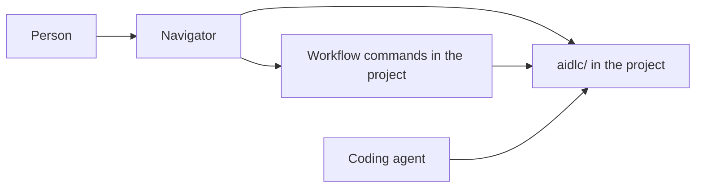

# Navigator

A one-pager for Navigator, an Electron app that helps a person follow an AI-DLC workflow on Windows, macOS, and Linux. The name is the job: where this work is, and what it is waiting on.

## Why it helps

AI-DLC keeps a written record under `aidlc/` in the project: the active piece of work, the phase, the stage, the decisions, and the documents each stage writes. The coding agent does the stage work in a chat. The chat is a poor map.

- A stage can run for a long time. The question that needs a human answer is easy to lose under the transcript.
- "Where are we?" is a line the agent says once. A later session does not replay the map.
- The record is a deep tree of markdown. The file a person is supposed to review is not obvious from the folder alone.
- The same `aidlc/` tree can be used from more than one coding agent. The transcript cannot. A person who changes agents, or machines, still needs one place that shows the workflow.
- Windows, macOS, and Linux users do not share one chat client. They can share one desktop app.

Navigator is that map, and it is also where the person acts. The coding agent still drafts the documents and the code. The person uses Navigator to see the phase and the current stage, answer a waiting question, approve a stage or send it back, claim a unit, and start or continue a bolt.

Text fallback: The person uses Navigator to read `aidlc/` and to answer, claim a unit, or run a bolt. Navigator writes those choices through the workflow commands already installed in the project. The coding agent still drafts the documents and the code.

## Why Electron

The record is on the local disk. A website would need the person to upload the project, or to run a private server. Electron is one codebase with a normal window, a folder picker, and installers for Windows, macOS, and Linux. It works offline. Markdown in the record can be shown in the window without a separate docs site.

## Who it is for

A person who already has an AI-DLC record in a repository and wants one place to see that workflow and to take the human steps in it: answering questions, including the ones mob elaboration raises, claiming a unit, and running bolts.

## Requirements

### Product

1. Navigator is one Electron codebase and runs on Windows, macOS, and Linux. Each system can open a project, read status, and read documents. No feature is limited to one operating system.
2. The person opens a project folder. The app looks for `aidlc/` at the root of that folder.
3. If `aidlc/` is missing, the app says the folder has no AI-DLC record and does not create one.
4. The app shows the active space and the active intent from `aidlc/active-space` and `aidlc/spaces/<space>/intents/active-intent`.
5. For that intent, the app shows the phase, the current stage, the status, and which stages are done, in progress, or skipped, using that intent's `aidlc-state.md`.
6. The app shows one next action: a question is waiting, an approval is waiting, a unit can be claimed, a bolt is waiting, or nothing is waiting.
7. The app lists the markdown documents for the current stage and renders the one the person selects.
8. The app finds question files that still have an empty answer and shows the question text, including questions raised while mob elaboration is folding specialist comments into a draft. The person answers in Navigator. The answer is written to that question's `[Answer]:` line.
9. When a stage is ready for a decision, the person can approve it or send it back with comments. Navigator records that choice on the workflow.
10. For team construction, Navigator lists units that are free to claim, units already claimed, and units that are waiting. The person claims a free unit under a team name they enter, and can release a unit they hold.
11. Navigator lists the bolts for the current work and shows each one as not started, running, paused, or waiting on a person. The person can start a bolt. When a bolt stops on a question, they answer it in Navigator and continue the bolt.
12. The app refreshes when files change on disk, so an agent can keep writing while the window stays open.
13. Navigator performs answers, approvals, claims, releases, and bolt actions through the AI-DLC commands installed in the opened project. When those commands are missing, it still shows status and documents, and it shows the actions as unavailable with the reason.

### Boundaries

14. Text inside a document is data. Navigator does not follow instructions it finds in a markdown file.
15. Navigator does not copy the project's source into itself. It remembers only local preferences, such as the last opened folder and the window size.
16. Navigator does not draft stage documents or write application code. The coding agent does that work. Navigator carries the person's decisions into the workflow.

### Quality

17. A project with a few hundred markdown files under `aidlc/` shows the current stage within a couple of seconds on a typical laptop.
18. The window is usable at a normal laptop width on all three systems.
19. The app does not send file contents or project paths off the machine.

## Out of scope for the first version

- Replacing the coding agent that drafts documents and code.
- A general chat with a model inside Navigator.
- Editing application code in the window.
- Accounts, sync, or a hosted service.
- A separate plugin for each coding agent.

## Done when

On Windows, macOS, and Linux, a person can open Navigator, open a project, see the current stage, and read the document that stage wrote. From that same window they can answer a waiting question, including one raised in mob elaboration, approve a stage or send it back, claim or release a unit, and start a bolt or answer the question it is waiting on.

## After this page

Scaffold Navigator on the `feat/navigator` branch only after this page is accepted. The branch starts from current `awslabs/aidlc-workflows` `main`, and the pull request goes back to that repository.
